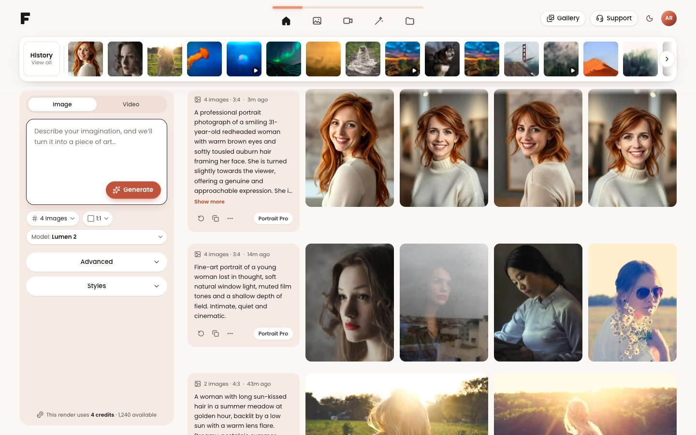
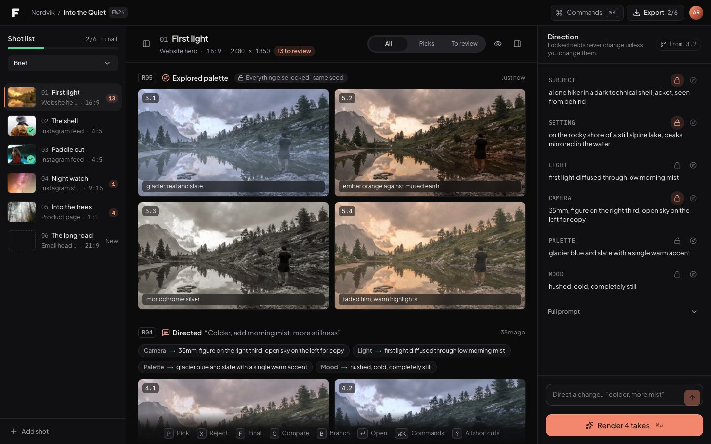
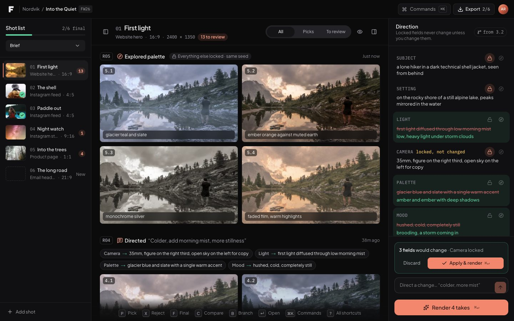

# Fomi: Frontend Developer Assessment

Two workspaces for an AI image and video platform, built with **Next.js 16, React 19, JavaScript and Tailwind CSS v4**.

| | What it is | Live |
|---|---|---|
| **Part A · Create** | The provided mockup, implemented as a production-quality, fully responsive generation workspace | [https://fomi-studio-arafatidris.vercel.app](https://fomi-studio-arafatidris.vercel.app) |
| **Part B · Fomi Studio** | My redesign of the Image Generation Workspace for professionals: *direct, don't re-roll* | [https://fomi-studio-arafatidris.vercel.app/studio](https://fomi-studio-arafatidris.vercel.app/studio) |

Product thinking document (Part B): **[docs/PRODUCT_THINKING.md](docs/PRODUCT_THINKING.md)**



---

## Two-minute tour

**Create (`/`)**
1. Type a prompt (try *"a golden retriever puppy in autumn leaves"*) and press **Generate** (or <kbd>⌘</kbd> <kbd>↵</kbd>). A pending card appears instantly, progress is reported by the mock API, and the results "develop" into focus.
2. Click any image to open the viewer (arrows to move, <kbd>F</kbd> to save, mock 2× upscale, reuse the prompt and settings).
3. Switch tabs: **Image**, **Video** (hover a tile to play), **Edit** (pick an image, describe a change, then drag the before/after slider), **Assets** (search and favorites).
4. Toggle dark mode (the moon icon), open **Gallery** for community prompts, press <kbd>?</kbd> for shortcuts, resize to mobile.

**Studio (`/studio`)**
1. You're a returning creator on the *Nordvik / Into the Quiet* campaign. The shot list shows what's final and what needs review.
2. In **Direction**, click the compass icon beside **Palette** → *Render sweep*. Four takes come back with only the palette changed: same frame, same seed.
3. Type *"warmer and more dramatic, closer"* in **Direct a change**. Fomi proposes a diff (Camera is locked, so it's left alone). Apply with <kbd>⌘</kbd> <kbd>↵</kbd>.
4. Review at keyboard speed: arrows between takes, <kbd>P</kbd> pick, <kbd>X</kbd> reject, <kbd>F</kbd> final, <kbd>C</kbd> compare, <kbd>⌘</kbd> <kbd>K</kbd> for everything else.

> Tip: include `#fail` in a Create prompt to see the error and retry states. Both workspaces persist to `localStorage`; use **Reset demo** in the account menu to start over.

---

## Part A: implementing the design

Built to match the mockup's layout, hierarchy and warm coral palette, then finished as a real product:

- **Faithful structure:** "F" mark, centred tab bar with the sliding coral indicator, floating History card that the feed scrolls beneath, peach composer panel with the dark-bordered prompt box, `# Images · ratio · Model: Name` pills, Advanced and Styles sections, and prompt cards beside 4-up results.
- **Real interactions:** optimistic generation with progress and queueing, accessible dropdowns, aspect-ratio and model pickers, style presets, seed and guidance controls, a full-screen viewer, a searchable History dialog grouped by day, community gallery, favorites, delete with undo, and copy or reuse prompts.
- **Every state designed:** loading skeletons, queued/rendering progress, render failure with retry, infinite-scroll loading and its error, an empty state per tab with one-click starter prompts, and "you're all caught up".
- **Responsive by intent, not by scaling:** a sidebar composer on desktop; on tablet and mobile the prompt docks to the bottom within thumb reach and its settings open in a bottom sheet. The nav stays reachable at 360px, and large displays get larger media.
- **Intentional deviations** (the brief invites "minor tweaks"):
  - Generate is `#C0533B`, not the mockup's `#E8917B`, so white text meets WCAG AA (4.6:1 instead of 2.4:1).
  - Copy fixes: "Describe *your imagination*…", "Advanced".
  - The model pill wraps to its own row instead of truncating at narrow widths.
  - The real credit cost appears before you click Generate.

## Part B: Fomi Studio

The full rationale is in **[docs/PRODUCT_THINKING.md](docs/PRODUCT_THINKING.md)**. In short, generation keeps getting cheaper and better, so the bottleneck moves to *direction* and *selection*. Studio is built around both:

- **Shot list, not a feed.** Work is organised by the campaign's deliverables (aspect ratio, size, status). A returning user sees what's final and what's waiting.
- **Direction, not a prompt blob.** The prompt is split into Subject, Setting, Light, Camera, Palette and Mood. Each field can be **locked**, edited inline or **explored** (a 4-take sweep that varies one field while everything else, including the seed, stays fixed).
- **AI edits as reviewable diffs.** Plain-language direction ("colder, more mist") becomes a proposed change set shown on the fields themselves. Locked fields are never touched. Nothing renders until you approve.
- **Culling at keyboard speed.** Pick/reject/final, filters, A/B compare with a split slider and a field-level diff, branching a direction from any take, and a ⌘K command palette.
- **Neutral, chroma-free dark UI** so the chrome doesn't bias colour judgement. On phones Studio becomes a review tool: big pick/reject buttons and swipe between takes.

| | |
|---|---|
|  |  |
| *Explore one variable: palette sweep, same seed* | *A plain-language change becomes a diff to approve* |

---

## Architecture

```
src/
├─ app/
│  ├─ (create)/            Part A routes sharing one layout: /, /image, /video, /edit, /assets
│  ├─ studio/              Part B route (own fonts, neutral theme scope)
│  ├─ api/                 Mock backend (Route Handlers)
│  ├─ globals.css          Design tokens (3 themes), base styles, keyframes
│  ├─ opengraph-image.js   Social card, rendered at build time
│  └─ icon.svg, not-found.js
├─ components/
│  ├─ ui/                  Accessible primitives: Button, IconButton, Tooltip, Popover, Select,
│  │                       Menu, Dialog, SegmentedControl, Disclosure, Toast, Kbd, Avatar
│  ├─ create/              Part A: shell, composer, feed, viewer, history, edit, assets…
│  └─ studio/              Part B: store, shot rail, stage, takes, direction, viewer, ⌘K
├─ data/                   Seed library, Studio project, models, styles, media manifest
├─ hooks/                  useHotkeys, usePersistentState, useGenerationFeed, useMediaQuery, useNow
└─ lib/
   ├─ api/                 Typed-ish fetch client (ApiError, abort-aware)
   ├─ mock/                Server-only engines behind the API routes
   ├─ media/               Aspect ratios, manifest lookup (server-only)
   ├─ store.js             40-line external store for Studio
   └─ utils/               cn (tailwind-merge), formatting, hashing, positioning
scripts/build-media.mjs    Reproducible demo-asset pipeline (crops, colour grades, videos)
```

**Key decisions**

- **Static-first rendering.** With Cache Components on, every page is prerendered: the first paint, including the first feed page and the whole Studio project, is static HTML from the CDN. Only API routes run per request. The clock never affects render: relative times come from data, and live clocks start after mount.
- **A realistic mock API.** `POST /api/generations` returns `202` with a job; the client polls `GET /api/generations/:id` for `queued → running → succeeded | failed`, the same contract as real inference providers. Job IDs encode the request and start time, so the mock is **stateless** and correct on any serverless instance, and in-flight jobs survive a reload. Results are matched to the prompt by keywords, and validation returns `422` with a field.
- **State that doesn't over-render.**
  - **Create** splits composer state from workspace state, so typing never re-renders the feed. Feed items are memoized and receive stable callbacks, so polling one render re-renders one card.
  - **Studio** uses a tiny external store with selector subscriptions over normalized data, so rating a take re-renders only that card.
- **Platform over libraries.** Popovers use the native Popover API: top layer, light dismiss, no z-index wars. Modals use `<dialog>`: real focus trap, `inert` background, Escape and focus return. Enter/exit animations use `@starting-style`. No animation or UI-kit dependency; runtime dependencies are `next`, `react`, `lucide-react` and `tailwind-merge`.
- **Design tokens, three themes.** One semantic token set (`canvas`, `surface`, `panel`, `ink`, `accent`…) with values for Create light, Create dark and Studio. Shared primitives render correctly in both products without variants.

### Mock API

| Method & path | Purpose |
|---|---|
| `GET /api/generations?type=all\|image\|video&cursor=&limit=` | Cursor-paginated library |
| `POST /api/generations` | Create a render job → `202 { job }`; `422` on invalid input |
| `GET /api/generations/:id` | Job status, eased progress, result |
| `GET /api/models` | Model catalogue (static) |
| `POST /api/studio/rounds` · `GET /api/studio/rounds/:id` | Render a Studio round (generate / explore / direct) |
| `POST /api/studio/suggest` | Four suggested values for an axis sweep |
| `POST /api/studio/direct` | Plain-language instruction → field-level changes (respects locks) |

## Accessibility

Built in from the first component:

- Semantic landmarks, a skip link and correct heading order.
- Every icon button has a label (the component requires one).
- WAI-ARIA patterns for listbox, menu, radiogroup, toolbar (roving tabindex) and slider.
- Full keyboard support, with visible focus rings everywhere.
- Native modal semantics, `inert` collapsed sections and `aria-live` toasts and progress.
- Meaningful `alt` text from prompts, and AA contrast checked per token.
- `prefers-reduced-motion` respected.

## Performance

- `next/image` everywhere with AVIF/WebP, accurate `sizes` and blur placeholders. A single LCP image per page is high priority and decodes with the first paint; the rest load lazily.
- Tailwind's stylesheet (~15 KB gzip) is inlined into the HTML, removing the render-blocking CSS request for first-time visitors. Under mobile throttling this roughly halved time to first paint (~810 → ~450 ms on Studio).
- Overlays (viewer, dialogs, ⌘K) are code-split with `next/dynamic` and load on first use.
- Popover lists, collapsed sections and mobile sheets mount only when opened.
- `content-visibility: auto` on feed items, videos fetched only on hover, and fonts self-hosted via `next/font`.
- Immutable caching for media.

**Lighthouse (live deployment)**

| Page | Performance (mobile / desktop) | Accessibility | Best practices | SEO | CLS |
|---|---|---|---|---|---|
| Create `/` | 91–96 / 100 | 100 | 100 | 100 | 0 |
| Studio `/studio` | 86–96 / 100 | 100 | 100 | 100 | 0 |

Measured with Lighthouse 12 on the Vercel deployment. Mobile uses Lighthouse's default simulated throttling (slow 4G, 4× CPU slowdown); its scores vary between runs, so the range is shown.

## Running locally

```bash
npm install
npm run dev          # http://localhost:3000 (Studio at /studio)
npm run lint
npm run build && npm start
npm run media:build  # optional: rebuild /public/media from sources (downloads ~150 MB once)
npm run submission -- --name="Your Name"   # optional: rebuild the submission PDF (uses local Chrome)
```

Pushes to `main` deploy to production on Vercel automatically.

Requires Node 20.9+.

## Credits

- **Photography:** Unsplash License, via [Lorem Picsum](https://picsum.photos). Studio sweeps derive every take from a single plate (crops for camera, colour grades for light, palette and mood), so only the explored variable changes.
- **Portraits** in the first Create row: genuine [FLUX.1 \[schnell\]](https://huggingface.co/black-forest-labs/FLUX.1-schnell) renders of that row's prompt (Apache-2.0).
- **Fonts:** Poppins, Plus Jakarta Sans and IBM Plex Mono (SIL OFL). **Icons:** Lucide (ISC).
